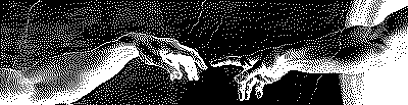

  

<h1 align="center">Hi 👋</h1>

<samp>Just code.</samp>

## 🤝 Connect

  

## 💻 Tech Stack

  

## 📊 GitHub Stats

  

## 📈 Activity Graph

  

## 🐍 Contribution Snake

  <picture>
    <source media="(prefers-color-scheme: dark)" srcset="https://raw.githubusercontent.com/artocq/artocq/output/github-snake-dark.svg" />
    <source media="(prefers-color-scheme: light)" srcset="https://raw.githubusercontent.com/artocq/artocq/output/github-snake.svg" />
    
  </picture>

